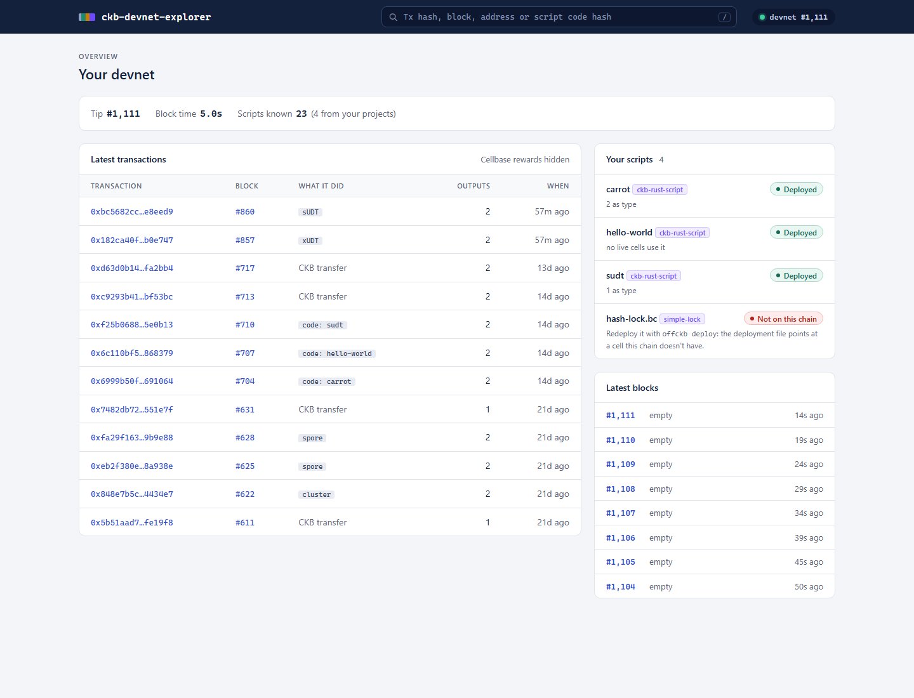
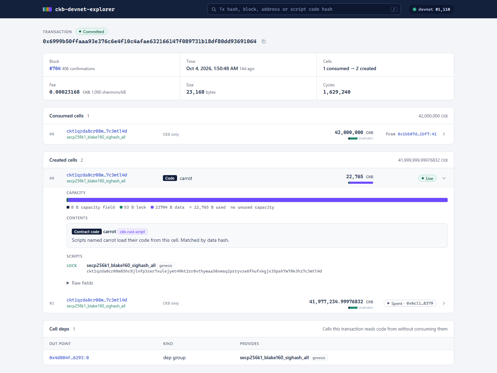
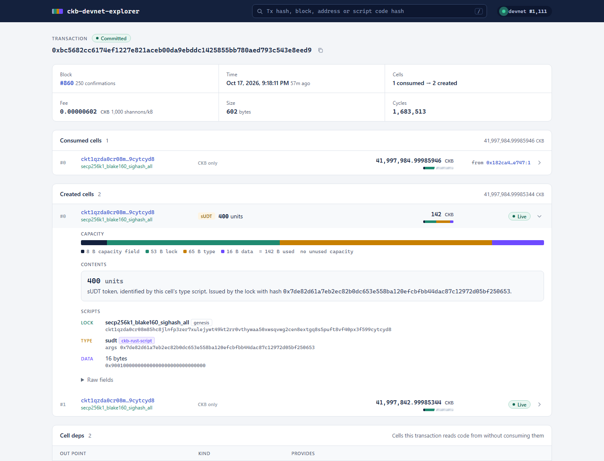
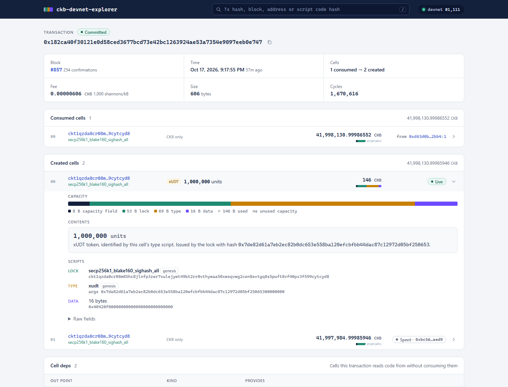
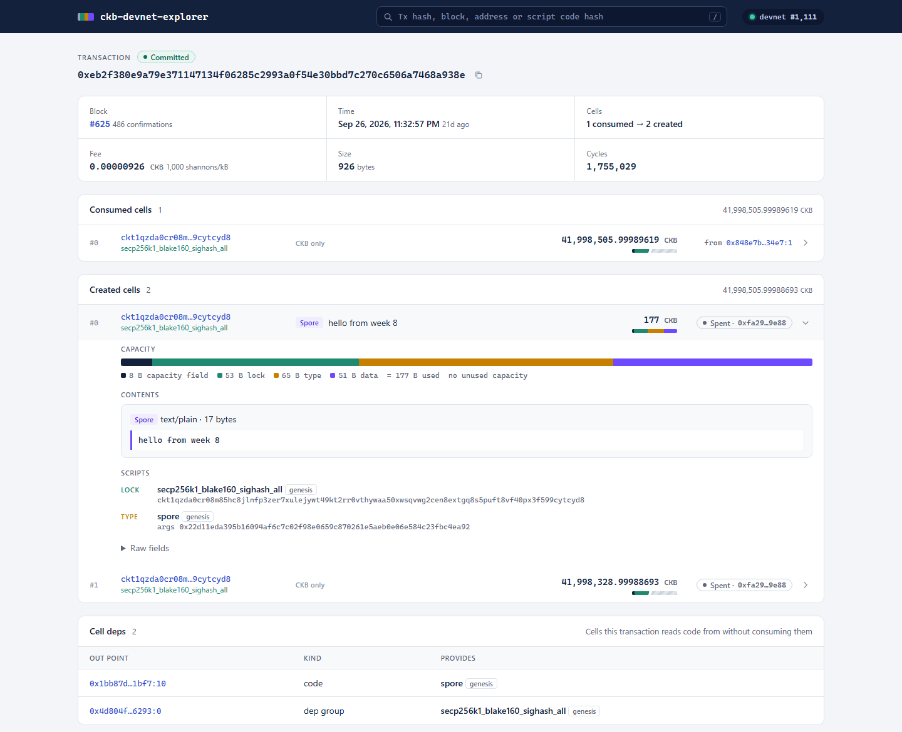
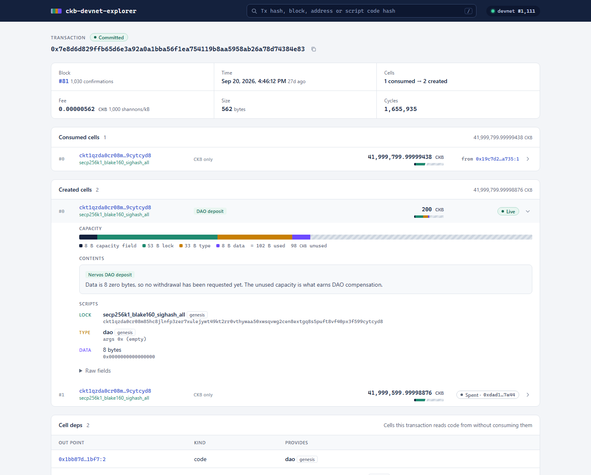

# Builder Track Weekly Report — Week 11

**Name:** Wildan Rahman
**Week Ending:** October 18, 2026

### Courses Completed

- Capstone week 3: [ckb-devnet-explorer](https://github.com/wildanrhmn/ckb-devnet-explorer) now reads what's inside each cell, not just which scripts guard it
- Background reading for it: [RFC 0022](https://github.com/nervosnetwork/rfcs/blob/master/rfcs/0022-transaction-structure/0022-transaction-structure.md) (how a script finds its code), [RFC 0052](https://github.com/nervosnetwork/rfcs/blob/master/rfcs/0052-extensible-udt/0052-extensible-udt.md) (xUDT), [RFC 0023](https://github.com/nervosnetwork/rfcs/blob/master/rfcs/0023-dao-deposit-withdraw/0023-dao-deposit-withdraw.md) (DAO), and the source of the official [CKB Explorer frontend](https://github.com/nervosnetwork/ckb-explorer-frontend) to see how it presents cells

### Key Learnings

- A contract cell can be recognised from the outside. RFC 0022 says a script with hash type `data`/`data1`/`data2` loads its code from the cell whose `ckbhash(data)` equals its `code_hash`, and with `type` from the cell whose type script hashes to it. So hashing each cell's data and type script, and checking them against the known scripts, tells you which cells hold code. My carrot deployment now shows as "Contract code: carrot (ckb-rust-script), matched by data hash" instead of `22704 bytes`.
- Every standard I studied in weeks 3 to 8 has a fixed data layout, so one function can read them all once the type script is named:
  - DAO: 8 bytes, all zero for a deposit, otherwise the deposit's block number (a withdrawal was requested)
  - sUDT and xUDT: a 16-byte little-endian amount, and xUDT can carry extra data after it. The type args start with the owner's lock hash, which is the token's identity
  - Spore and cluster: molecule-encoded, decoded with the codecs CCC already ships in `@ckb-ccc/spore/advanced` rather than hand-written parsing
- The official explorer marks every output as live or dead and links a dead one to the transaction that consumed it. The node can answer that without a database: `get_live_cell` says whether the cell still exists, and the node's built-in indexer (`get_transactions` on the cell's lock, ascending from the block that created it) finds the transaction that spent it.
- The official explorer's backend sorts cells into about twenty kinds (DAO deposit, DAO withdrawing, UDT, xUDT, spore, cluster and more). That list was a good checklist for which decoders matter most.
- The Spore docs' recipe pages still use `@spore-sdk/core`, which is built on Lumos, so they weren't usable here. Same lesson as week 8.

### Practical Progress

- Added `src/decode.ts` (Nervos DAO, sUDT, xUDT, Spore, cluster, Type ID), code-cell detection in the resolver, and live/spent lookup, fee, cycles and CKB addresses in the explorer. The page gained a decoded summary per cell, a live/spent marker linking to the spending transaction, tags in the feed (`code: carrot`, `xUDT`, `spore`...) and a collapsible raw fields view.
- My devnet had no tokens after the week 7 reset, so I minted two to test with:
  - 1,000,000 units of a genesis xUDT (`0x182ca40f30121e0d58ced3677bcd73e42bc1263924ae53a7354e9097eeb0e747`)
  - 400 units with **my own sUDT contract from week 6** (`0xbc5682cc6174ef1227e821aceb00da9ebddc1425855bb780aed793c543e8eed9`). That was its first run on-chain; before this it had only passed unit tests. The owner-mode mint went through.
- Checked against real transactions: the carrot deploy (fee 0.00023168 CKB, 1,629,240 cycles), both tokens, the week 8 spore ("hello from week 8", spent in the transfer tx), the cluster, and the week 7 DAO deposit, which shows 102 bytes used and 98 CKB free. That free part is the capacity that earns DAO compensation.
- Bug found while testing: "spent by" came back empty when a transaction page was opened directly. The search's block range ended at a cached tip that hadn't been fetched yet. It now refreshes the tip first.
- Wrote `docs/ARCHITECTURE.md` (how each part works, with the RFC links), added a `tsconfig.json` and `npm run check`. Pushed as `0c717d2`.
- Then redesigned the UI. The old one was a single page that worked but didn't look like an explorer, so I went through the official explorer's transaction and home pages and rebuilt it around the same layout, but for a devnet:
  - Overview with the latest transactions and blocks, refreshing as the devnet mines, and a "Your scripts" panel that checks whether each script in my projects is actually on this chain. It flagged `hash-lock.bc` from simple-lock: its `scripts.json` still points at a code cell that isn't on my current devnet anymore.
  - Transaction page with confirmations, fee rate, size and cycles (the RPC doesn't return size, so the tx is serialized with CCC), the cell deps, and every cell as a row that expands to its capacity bar, contents and scripts.
  - New block, address (balance, tokens, live cells, history) and script pages, plus search for a tx hash, block, address or code hash.
  - Checked at phone, tablet and desktop widths. Pushed as `981f619` and `1aeee0f`.

**Evidence:**

### Environment

- WSL2 Ubuntu, Node 22, offckb 0.4.11
- New dependencies in the explorer: `@ckb-ccc/core` (hashing, addresses) and `@ckb-ccc/spore` (spore/cluster codecs)

### Plan for Next Week

- One-command install so it runs without cloning the repo
- Finish the docs and record a short demo
- Not covered yet: a DAO withdrawal-request cell on a real chain, and the genesis code cells (matched by type hash) haven't been checked on screen
