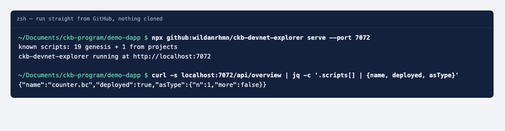
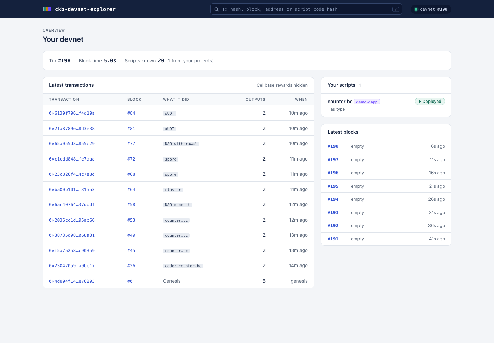
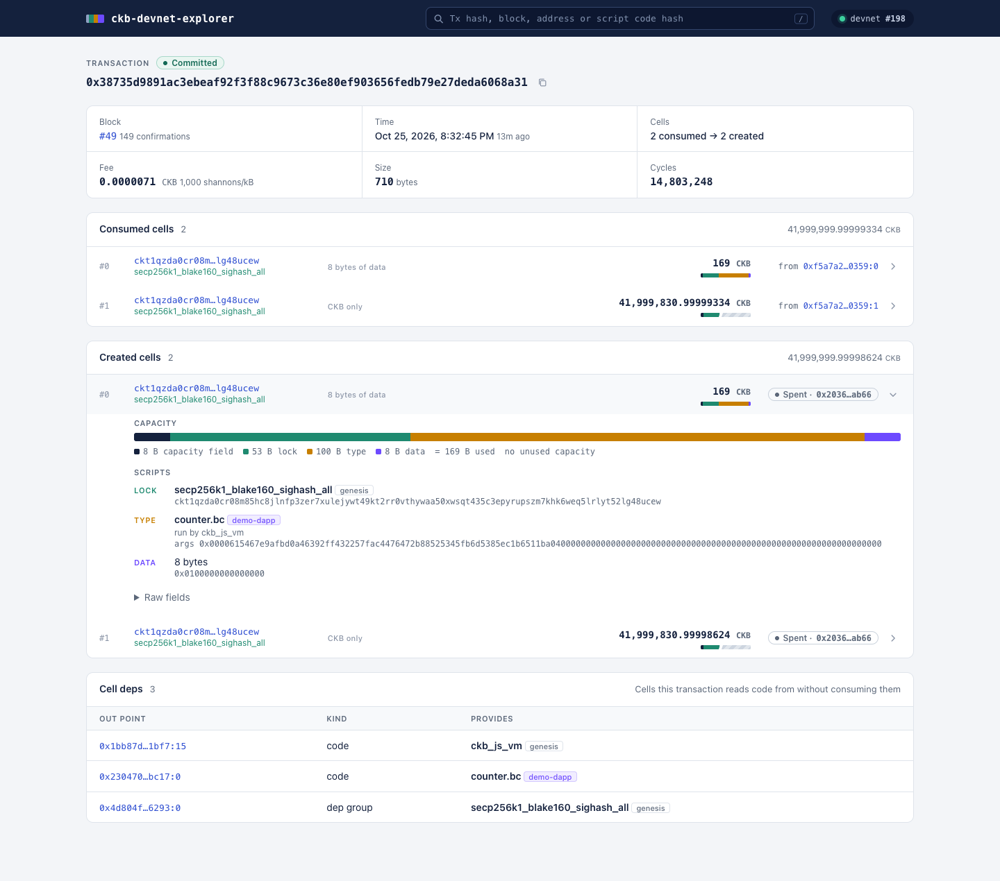
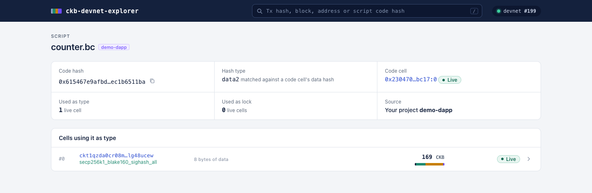
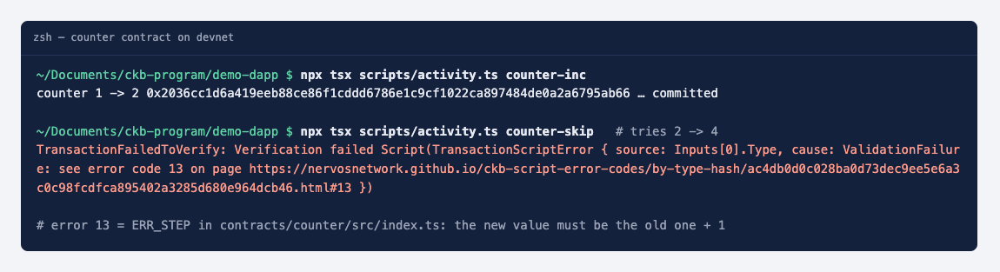
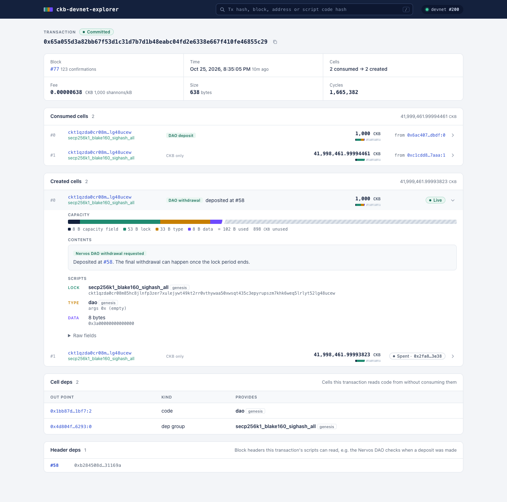
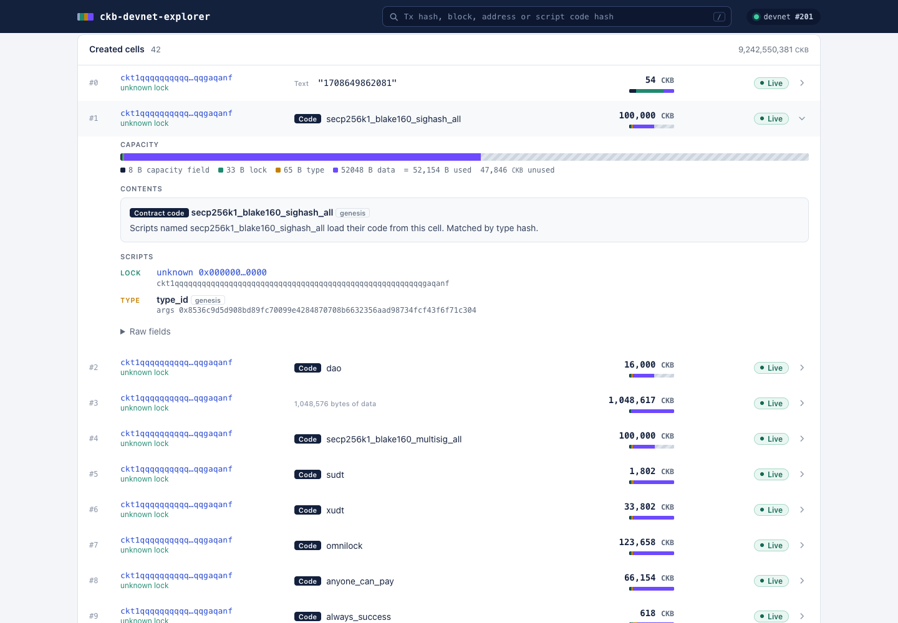

# Builder Track Weekly Report — Week 12

**Name:** Wildan Rahman
**Week Ending:** October 25, 2026

### Courses Completed

- Capstone week 4: [ckb-devnet-explorer](https://github.com/wildanrhmn/ckb-devnet-explorer) now runs with one command and no clone: `npx github:wildanrhmn/ckb-devnet-explorer serve`
- I was away from my PC this week, so I set everything up from scratch on my laptop (macOS): offckb, a fresh devnet, and a new JS contract project made with `offckb create`. That doubled as a test of the explorer on a machine and chain it had never seen
- Closed the two items left open in week 11: a DAO withdrawal request on a real chain, and genesis code cells matched by type hash

### Key Learnings

- `npx github:user/repo` installs the repo like a package and runs its `bin`, but it only installs `dependencies`, not `devDependencies`. My `bin` pointed straight at `src/cli.ts` and relied on `tsx`, which was a dev dependency, so it could never have worked that way. Node's own type stripping doesn't help either, since it refuses `.ts` files inside `node_modules`. The fix that keeps the "no build step" rule: a 5-line JS launcher in `bin/` that registers tsx and imports the TypeScript entry, with `tsx` moved to `dependencies`.
- JS contracts hide from simple searches. A cell guarded by a JS contract carries `ckb_js_vm`'s code hash, not the contract's; the contract's code hash sits in the args (the same layout as the resolver uses since week 9). So the overview said my deployed counter had "no live cells" while one was sitting right there. Counting usage now runs a second indexer prefix search on `ckb_js_vm` with `0x0000 + code_hash + hash_type` as the args prefix.
- What a JS contract costs, read straight off the explorer:
  - Space: the counter cell occupies 169 bytes = 8 + 53 (lock) + **100** (type) + 8 (data). The type script is 100 bytes because the `ckb_js_vm` args are 67 bytes (2 flag bytes, 32-byte code hash, 1 hash type byte, plus 32 bytes the template passes to the contract). A Rust type script like carrot's is 33 bytes, so every JS-contract cell locks up about 67 CKB more.
  - Cycles: an increment took 14,803,248 cycles, against 1,665,382 for the DAO withdrawal request and 1,629,240 for my Rust carrot tx in week 11. The VM interprets the JS bytecode, and that shows.
- A DAO withdrawal request (phase 1, RFC 0023) consumes the deposit cell and recreates it with the same capacity, lock and type, but the data changes from 8 zero bytes to the deposit's block number. The transaction also needs the deposit block's hash as a **header dep**, so the DAO script can read when the deposit happened. The explorer wasn't showing header deps at all, so I added them (as block numbers, looked up with `get_header`).
- Block 0's first transaction holds all 19 system script code cells, and both matching rules from week 11 show up in it. The scripts referenced with hash type `type` (secp256k1, dao, sudt, xudt, omnilock, ckb_js_vm...) are found through the hash of the code cell's `type_id` type script, so they're labelled "Matched by type hash". The `data2` ones (spore, spore_cluster, nostr_lock...) are matched by data hash, like my own deployments.
- The devnet's genesis block has timestamp 0, so the feed said the genesis transaction happened "20752d ago" (1970). It now says "genesis".
- Smaller things I ran into:
  - Spore v2 on the devnet rejected my cluster with script error 8 until I set `cobuild: true` in the script info I passed to CCC, which makes it attach the cobuild action witness.
  - Two `offckb udt issue` runs back to back: the second picked the same input as the first, which was still in the pool, and the node rejected it as a replace-by-fee attempt with too low a fee (`PoolRejectedRBF`). Waiting one block fixed it.
  - After restarting the server the browser kept running the old page code, since the server sent no cache headers. Static files are now `Cache-Control: no-cache`, so updating the explorer actually updates the page.

### Practical Progress

- **One-command run.** `bin/ckb-devnet-explorer.js` launcher, `tsx` in `dependencies`, `files`/`engines` in `package.json`, version 0.2.0. Tested twice: from a packed tarball with `npx --package`, and after pushing, straight from GitHub in my project folder with nothing cloned. The current folder is the default `--project`, so the counter was named immediately.
- **CLI.** `--help`, and a clear message when `offckb` isn't on the PATH instead of a raw `ENOENT` stack trace.
- **Test project.** `offckb create demo-dapp` (TypeScript, ckb-js-vm). I replaced the template contract with a small counter: data is a little-endian u64, creating one must start at 0, and every update must add exactly 1 (error codes 10–13). 5 mock tests with ckb-testtool pass (create at 0, reject create above 0, increment, reject skipping ahead, reject wrong data length). Deployed with `offckb deploy`.
- **Devnet activity** (fresh chain, all on-chain):
  - counter deploy (tx `0x230470590c8ab2d472579d8ae847ced7d2e8718ffc2e4d2860f955997ba9bc17`), create at 0, then 0 → 1 → 2
  - counter 2 → 4: rejected by the node with error code 13, the contract's "must add exactly 1" check
  - Nervos DAO deposit of 1,000 CKB at block #58, then a withdrawal request (tx `0x65a055d3a82bb67f53d1c31d7b7d1b48eabc04fd2e6338e667f410fe46855c29`)
  - a spore cluster, a spore ("hello from week 12") and a transfer of it to another account
  - 1,000,000 xUDT and 400 sUDT with `offckb udt issue`
- **Explorer fixes from testing on this chain:** JS contract usage counts and script pages, JS contracts tagged by name in the transaction feed (`counter.bc` instead of "CKB transfer"), header deps panel, genesis time, "1 live cell" instead of "1 live cells", no-cache static files.
- **Docs.** README rewritten around the `npx` command (with an options table, global install and clone instructions) plus a demo GIF; ARCHITECTURE.md got sections on JS contracts and header deps; PLAN.md updated.
- Pushed as `bdc14d0`, `e6a88f6` and `477af44`.

**Evidence:**

### Environment

- This week: macOS (Apple Silicon), Node 24.20, offckb 0.4.13 (CKB 0.208.0, ckb-debugger 1.1.1). My usual setup is WSL2 Ubuntu with Node 22 and offckb 0.4.11
- Explorer: no new runtime dependencies, `tsx` moved from dev to runtime dependencies
- Test project: `offckb create` TypeScript template (`@ckb-js-std/core`, ckb-testtool), plus `@ckb-ccc/core` and `@ckb-ccc/spore` for the activity script

### Plan for Next Week

- Final week: the capstone write-up and a narrated demo video
- Run the npx version on my WSL setup against my week 9–11 projects (carrot, sUDT, simple-lock) to confirm nothing changed for Rust scripts
- Maybe: decode simple JS contract data (like the counter's u64), and publish to npm so the command is just `npx ckb-devnet-explorer serve`
- Still not covered: the final DAO withdrawal (phase 2), which needs the lock period to pass on the devnet
