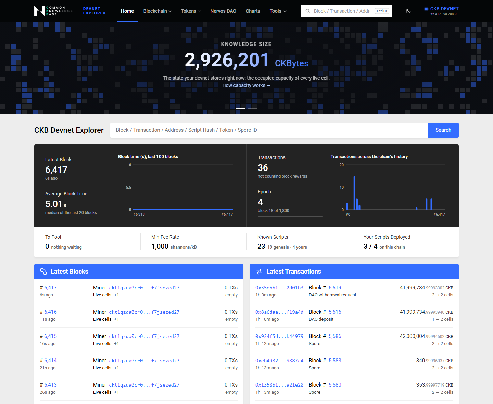
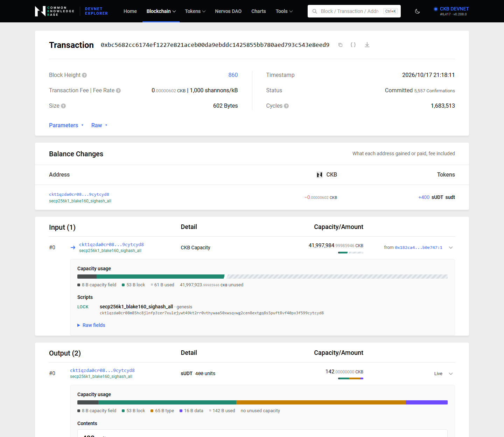
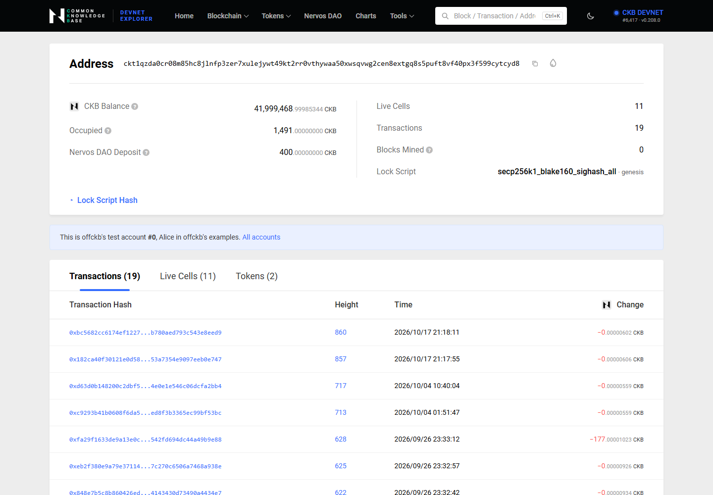
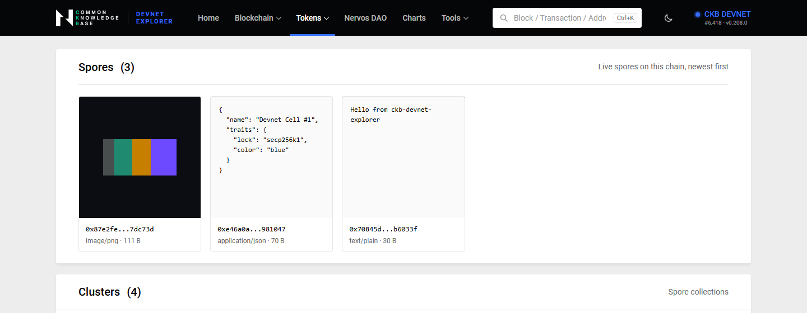
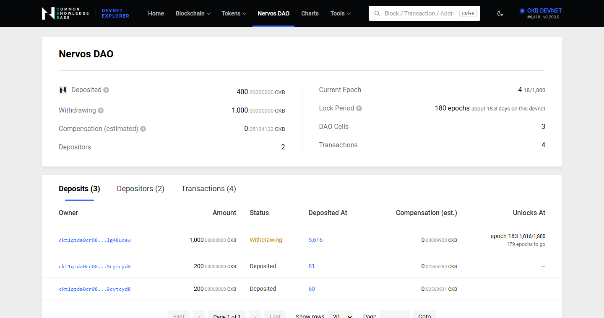
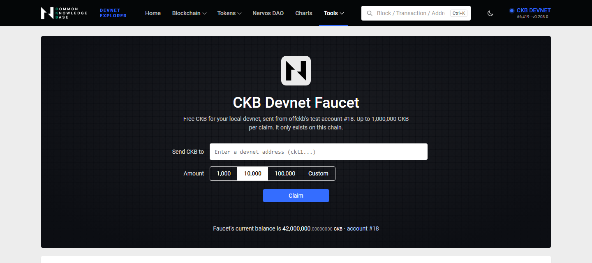
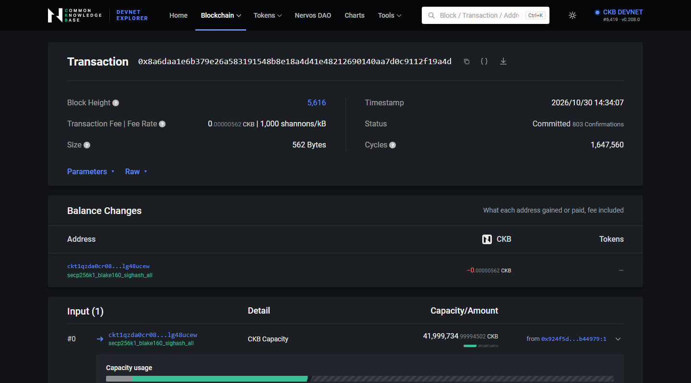
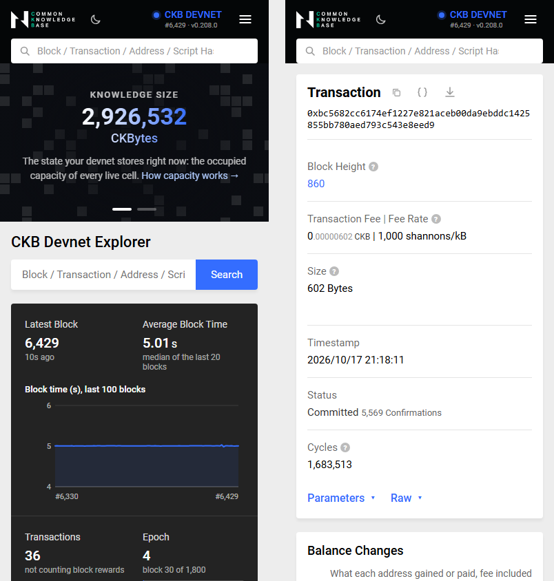

# Builder Track Weekly Report — Week 13

**Name:** Wildan Rahman
**Week Ending:** November 1, 2026

### Courses Completed

- Capstone week 5, the last one: [ckb-devnet-explorer](https://github.com/wildanrhmn/ckb-devnet-explorer) now has every page of the official CKB Explorer that makes sense on a devnet, built on the official explorer's design system
- Capstone write-up: [docs/CAPSTONE.md](https://github.com/wildanrhmn/ckb-devnet-explorer/blob/main/docs/CAPSTONE.md) (the problem, what I built week by week, how it works, results, what's left)
- Read for this week: the source of the official [CKB Explorer frontend](https://github.com/nervosnetwork/ckb-explorer-frontend) (its colour tokens, components and breakpoints), the [Nervos media kit](https://www.nervos.org/media-kit), [RFC 0023](https://github.com/nervosnetwork/rfcs/blob/master/rfcs/0023-dao-deposit-withdraw/0023-dao-deposit-withdraw.md) again for compensation, and the CKB RPC docs for the tx pool and `test_tx_pool_accept`

### Key Learnings

- The official explorer's primary colour tells you the network: green for mainnet, purple for testnet. I gave the devnet its own blue so a devnet page can't be mistaken for either. The Nervos media kit allows the logo and the CKB token icon in a UI as long as they aren't edited or recoloured, so the explorer uses them as they ship.
- Knowledge Size, the big number on the official home page, is U, the fourth field of a header's DAO data. My devnet first showed 5,042,849,993 CKBytes. offckb's devnet genesis has the same 8.4 billion CKB cell as mainnet, and 60% of it counts as occupied because it's due to be burnt. The official explorer subtracts that 5.04 billion, and doing the same gives about 2.85 million CKBytes, which is the system scripts plus my deployments.
- offckb's test accounts aren't all equal. Reading offckb's own code: #0, #1 and #2 are Alice, Bob and Carol from its examples, and #19 is `deployerAccount`, the default signer of `offckb deploy`. My carrot, sudt and hello-world code cells all belong to #19. I first pointed the faucet at #19, then moved it to #18, which offckb doesn't use.
- Two transfers built back to back from the same account pick the same input, and the node rejects the second (`PoolRejectedDuplicatedTransaction` or `PoolRejectedRBF`, which I also hit in week 12). The faucet now queues claims and waits for each one to commit; a second claim sent a second later waited about 14 seconds and went through.
- A rejected transaction is still visible: `get_transaction` on its hash returns status `rejected` and a JSON reason (`{"type": "Resolve", "description": ...}`), but not its contents. `test_tx_pool_accept` answers whether the node would accept a transaction, with its cycles and fee, without sending it. That became the dry run in the broadcast tool.
- DAO compensation (RFC 0023): the free part of a deposit grows with AR, the second field of each header's DAO data, so it's worth `free * AR_now / AR_deposit`. A withdrawal can complete after whole 180-epoch cycles. On my devnet an epoch is 1,800 blocks at about 5 seconds, so the lock period is about 18.8 days. That's why the final withdrawal (phase 2) still isn't covered.
- Reading the whole chain is cheap: 4,500 blocks take about 0.3 seconds in JSON-RPC batches of 200, so the explorer can keep its own list of blocks and transactions in memory for pagination and totals, with no database.
- Spore content is whatever the minter chose, so serving it raw could run a script (an SVG can carry one). Spore images are served image-only, with `nosniff` and a sandboxing content security policy.

### Practical Progress

- **Parity with the official explorer** (`b5133c1` to `2cd7e3c`): paginated blocks and transactions and the tx pool; fuller block pages (miner, reward breakdown, size, cycles); transaction pages with balance changes per address, Parameters and Raw toggles, witnesses and `since`; address pages with tabs for transactions, cells and tokens; script pages and a scripts list; tokens with holders; NFTs (spores with their content and history); the Nervos DAO with compensation and unlock epochs; charts; tools; and one search box for every kind of id.
- **The design system** (`dbcb51d`, `5b3fbb1`): their header, cards, tables, tabs, pager, grey decimals and breakpoints; the Knowledge Size banner over a Game of Life grid (the Nervos media kit calls that grid its "Cell Model" motif); dark mode and a phone menu.
- **Devnet extras:** a faucet (`005dd74`), offckb's 20 test accounts with their roles (`c7304a3`), rejected transactions with the node's reason, and the explorer resetting itself after `offckb clean`.
- **Test data**, from offckb's account #1 so my own #0 stays as it was: three spores (a text, a JSON document and a 24×24 PNG), because my week 8 script melts its spores, and a 1,000 CKB DAO deposit with its withdrawal request, so the DAO page has a withdrawing cell to show.
- **README rewritten** (`c76d56a`, `ef7a0e8`) with new screenshots, a tour GIF and a comparison with the official explorer.
- **offckb integration:** RetricSu opened [PR #1](https://github.com/wildanrhmn/ckb-devnet-explorer/pull/1), a public CLI contract (`--system-scripts`, `--host`, `--json`, `--bridge`) so offckb can run the explorer as a sandboxed plugin ([ckb-devrel/offckb#542](https://github.com/ckb-devrel/offckb/pull/542)). It conflicted with this week's changes, so I rebased it (he's still the author) and added a commit that makes the explorer read-only and CSP-clean inside his sandbox: his RPC gateway doesn't allow `local_node_info` or any write method, and his pages only run script files. All 6 of his tests pass, and I checked it on the real devnet in normal, `--json` and bridge mode. It's mergeable, waiting for him to mark it ready. This is the "standalone first, offckb later" plan from September 28 coming true.
- Last week's plan item "run the npx version on WSL against my Rust projects" is done: everything this week ran on my WSL devnet with carrot, sudt and simple-lock.

**Evidence:**

### Environment

- WSL2 Ubuntu, Node 22, offckb 0.4.11, CKB 0.208.0
- No new runtime dependencies. Roboto is bundled in the repo (Apache 2.0) so the explorer still works offline

### Plan for Next Week

- This was the last week of the program. What's left for the capstone:
  - Record the demo video
  - A hosted demo, as Neon suggested, so people can try it in the browser without installing anything: a devnet on a server with the explorer in front of it, read-only (the read-only mode from the offckb work fits this)
  - Merge PR #1 once RetricSu marks it ready, and publish `ckb-devnet-explorer@0.3.0` to npm if offckb wants to install it from there
  - Still not covered: the final DAO withdrawal (needs the 18.8-day lock period to pass) and decoding JS contract data such as the counter's u64
